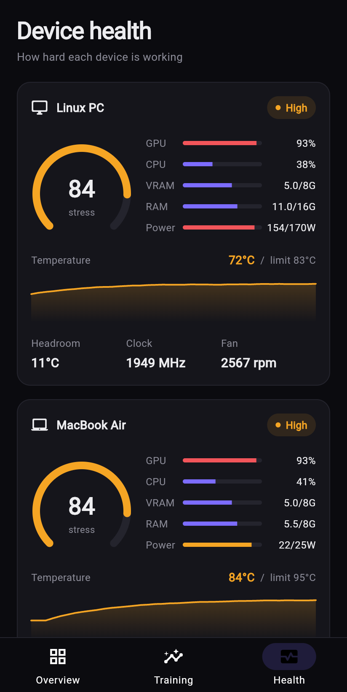
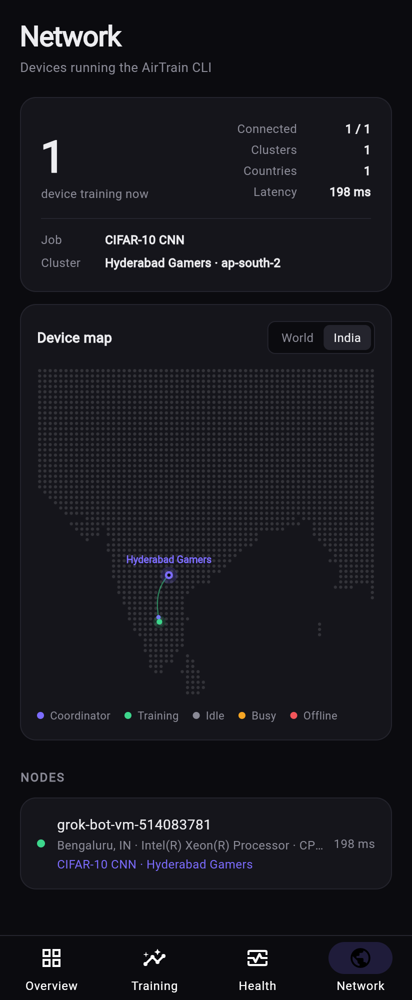
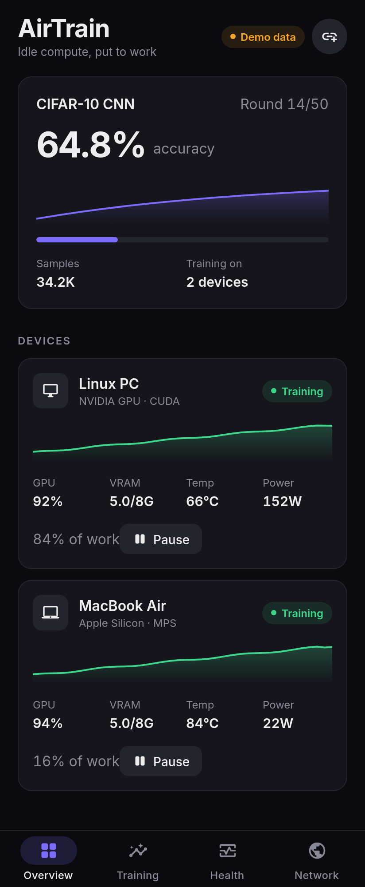
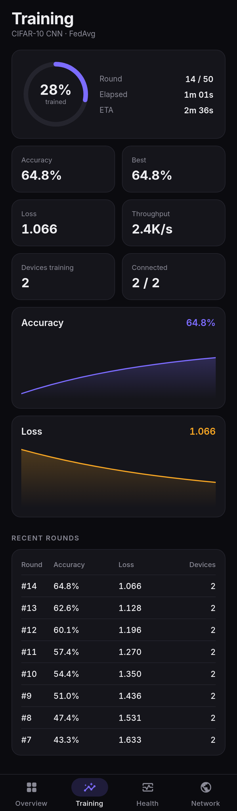
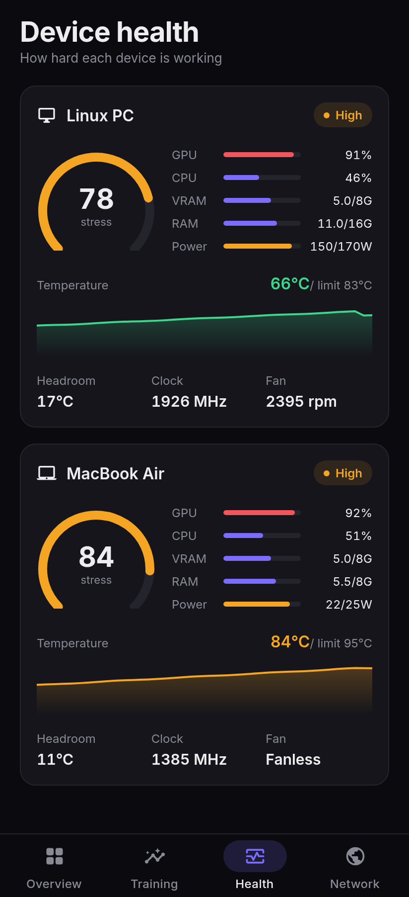
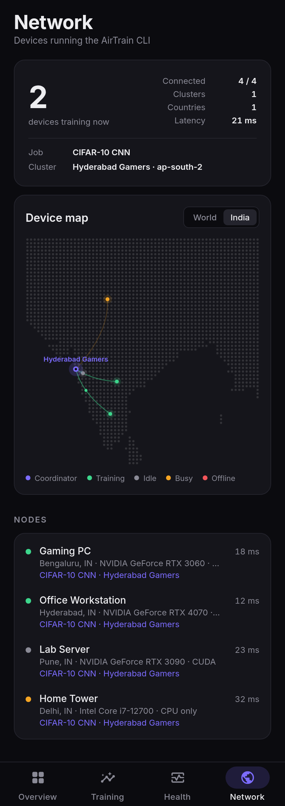

# AirTrain

AirTrain pools idle compute on laptops and desktops to collectively train a small model. A phone app monitors the devices, the job, and the cluster they have joined.

This repository holds:

| Path | What it is |
| --- | --- |
| `lib/` | Flutter phone dashboard (Overview, Training, Health, Network) |
| `agent/` | Python CLI that runs on each Windows or Linux PC |
| `web/` | React + TypeScript UI preview of the dashboard, on mock data |

## Flutter app

The dashboard has four tabs:

- **Overview** — job accuracy, round progress, and a card per device (utilization sparkline, memory, temperature, power, share of work). Pause or resume a device from here. Until a PC agent is paired, this tab and Health show demo data.
- **Training** — round progress, accuracy and loss charts, throughput, and a recent-rounds log.
- **Health** — a stress gauge and GPU, CPU, memory, power, temperature, clock and fan readings for each device.
- **Network** — only devices that have the AirTrain CLI installed and are paired. A World / India dotted map places each one at the location its agent reports, with an arc to its cluster's coordinator.

```bash
flutter pub get
flutter run            # connected phone
flutter run -d linux   # desktop preview
```





## Agent CLI

Install the agent on each Windows or Linux PC. The `[train]` extra pulls in PyTorch; omit it for monitoring only. Platform-specific notes are in [agent/README.md](agent/README.md).

```bash
python3 -m venv .venv && source .venv/bin/activate   # Windows: py -3 -m venv .venv; .\.venv\Scripts\Activate.ps1
pip install "./agent[train]"
```

The intended flow is three commands, each saving its result for the next:

```bash
airtrain analysis          # profile this machine and pick a job (CIFAR-10 CNN, tiny GPT, ResNet-18)
airtrain connect           # join the best-ranked cluster for that job
airtrain start training    # train while idle; prints the ws:// URL and token for the phone app
```

Other commands: `airtrain status` (one-shot snapshot, `--json` for raw telemetry), `airtrain serve` (WebSocket server for the app, with optional `--train`), `airtrain train` (local idle training without the server), `airtrain disconnect`, `airtrain token`, and `airtrain config`. Full options and settings are in [agent/README.md](agent/README.md).

### Pairing with the app

`airtrain start training` and `airtrain serve` print a LAN `ws://` URL that includes a pairing token (or pass the token separately). In the app, tap the link button on Overview — or Pair device on the Network empty state — and paste that URL. The phone and the PC must be on the same network. Paired agents are remembered and stream telemetry about once a second; pause and resume from a device card are sent back to the agent.

### How the CLI reads hardware

- **GPU** — NVIDIA Management Library through `pynvml` (`nvidia-ml-py`): utilization, VRAM, temperature and limits, power, fan, clocks, and throttle reasons. Machines without an NVIDIA GPU report CPU and RAM instead and train on the CPU.
- **System** — `psutil` for CPU load and frequency, RAM, and battery.
- **Idle** — Windows uses `GetLastInputInfo`. Linux tries `xprintidle`, then the GNOME Mutter idle timer over D-Bus, then terminal activity. Training runs only when the machine is idle and within temperature, battery, and GPU-busy limits.
- **Training** — PyTorch on CUDA when a supported NVIDIA GPU is present, otherwise CPU.

Details, job catalog, and config keys: [agent/README.md](agent/README.md).

## React UI preview

`web/` is a component-only React port of the dashboard. It matches the Flutter layout and uses mock data with a one-second update loop; it does not open a WebSocket to an agent. See [web/README.md](web/README.md).

```bash
cd web
npm install
npm run dev
```

Open the URL Vite prints (http://127.0.0.1:5173). Append `?tab=overview`, `?tab=training`, `?tab=health`, or `?tab=network` to land on a tab. `npm run build` type-checks and builds; `npm run preview` serves that build.









## Status and limitations

- The coordinator is a local mock. `airtrain connect` ranks mock clusters; it does not talk to a real service yet.
- Rounds are local. There is no FedAvg (or other aggregation) across devices.
- The tiny GPT and ResNet-18 jobs train on synthetic data until their real datasets are wired in. CIFAR-10 uses the real dataset (downloaded on first train).
- The agent supports Windows 10/11 and Linux only. macOS is not supported.
- GPU telemetry and CUDA training cover NVIDIA only. AMD and Intel GPUs fall back to CPU and RAM reporting and CPU training.
- The app talks to agents over LAN `ws://` only.
- IP geolocation is city-level and may show the ISP's city. Set `location` (or `lat`/`lon`) in config for an exact spot, or turn the lookup off. See [agent/README.md](agent/README.md).

## Roadmap

- A FastAPI coordinator so `connect` finds real clusters and devices register against a shared job.
- FedAvg across the cluster, so local rounds become federated rounds the dashboard can follow.
